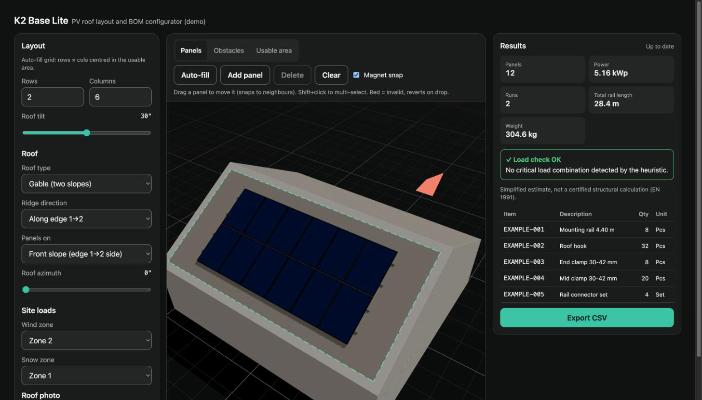
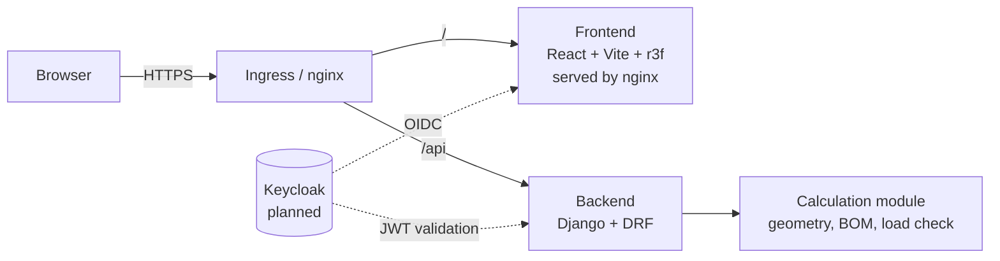

# K2 Base Lite

A small, end-to-end PV mounting configurator: enter a panel grid and site parameters, see a 3D preview on a tilted roof, and get a bill of materials with a simplified load hint.

Built as a portfolio demo to show how I approach a full-stack product slice: Django API, React + 3D frontend, tests, CI/CD, containers, Kubernetes and written architecture decisions.

> **Not affiliated with K2 Systems.** Item numbers are placeholders, and the load check is not a structural calculation. See [Limitations](#limitations).



## Features
- **Roof from a satellite photo:** upload any screenshot, rotate/auto-straighten it, click 4 corners and one real edge length; a 4-point homography rectifies it onto the 3D roof
- **Gable or mono-pitch roofs** with ridge direction, active slope and azimuth
- **Usable area** (e.g. your half of a semi-detached house) and **obstacles** (roof windows, chimneys) with keep-out clearance
- **Drag-and-drop panel editor** glued to the roof plane, magnet snap to neighbours (toggle), multi-select, collision checks, auto-fill around obstacles
- **BOM from the real layout:** panels are grouped into runs; each run gets its own rails, hooks, clamps and connectors (Django service, `runs` API)
- Simplified wind/snow load check with an explicit disclaimer, CSV export
- Field-level validation (DRF serializers), health endpoint, optional Keycloak/OIDC JWT auth hook

## Architecture

- API contract: [CONTRACT.md](CONTRACT.md)
- Architecture: [docs/arc42.md](docs/arc42.md)
- Decisions: [docs/adr/](docs/adr/)

## Quickstart (Docker)
```bash
docker compose up --build
# frontend: http://localhost:8080
# backend:  http://localhost:8000/api/health/
```

## Local development
Backend:
```bash
cd backend
python3.12 -m venv .venv && source .venv/bin/activate
pip install -r requirements.txt -r requirements-dev.txt
python manage.py runserver 8000
```
Frontend (proxies `/api` to :8000):
```bash
cd frontend
npm install
npm run dev   # http://localhost:5173
```
Example request:
```bash
curl -X POST localhost:8000/api/calculate/ -H 'Content-Type: application/json' \
  -d '{"rows":2,"cols":5,"roof_tilt":30,"wind_zone":2,"snow_zone":1}'
```

## Testing
```bash
cd backend && ruff check . && pytest
cd frontend && npx vitest run
```
CI (`.github/workflows/ci.yml`) runs both on every push and PR and builds the Docker images on `main`.

## Kubernetes
Manifests for kind/minikube in [infra/k8s/](infra/k8s/README.md): namespace, deployments with probes and resource limits, services, ingress, HPA.

## Limitations
- **Simplified load estimate.** Wind/snow zones map to a heuristic. It is not a certified structural calculation (EN 1991) and must not be used for real installations.
- **Placeholder item numbers.** All `EXAMPLE-` item numbers and descriptions are invented, not real catalog data.
- **Fixed panel type.** One panel size (1.134 × 1.722 m, 430 W), portrait only. Photo scale depends on the edge length the user enters.
- **No auth or persistence yet.** Keycloak is designed (ADR-0003), not implemented.
- **Not affiliated with K2 Systems.** Independent demo for a job application.

## Roadmap
1. Keycloak login (OIDC, PKCE) and saved projects (PostgreSQL)
2. Configurable panel catalog and landscape orientation
3. Address lookup via Google Solar API (pitch, azimuth and scaled imagery instead of manual calibration)
4. Helm chart, OpenTelemetry tracing, Prometheus metrics
5. Playwright end-to-end tests in CI
